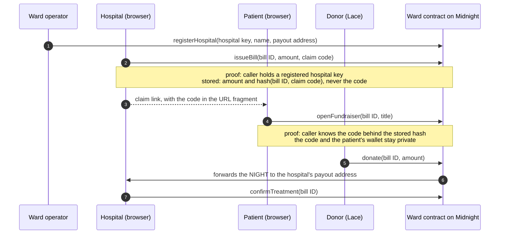

# Ward

**Hospital-verified medical fundraising on [Midnight](https://midnight.network).**
*Prove the bill is real. Keep the diagnosis private.*

Ward lets a hospital vouch for a medical bill on-chain, lets the patient raise money for it without revealing who they are or what they are being treated for, and guarantees that every donation goes straight to the hospital.

**Live on Midnight Preprod:** contract `e6070a97918b0706e94daf2c41bd88e9262a662ae893b08de516d9af6b70b698` (see [`ward-cli/deployments/preprod.json`](ward-cli/deployments/preprod.json)).

## The problem

About 2.1 billion people face financial hardship paying for healthcare ([WHO and World Bank, 2025](https://www.who.int/news/item/06-12-2025-most-countries-make-progress-towards-universal-health-coverage-but-major-challenges-remain-who-world-bank-report-finds)), and medical needs make up roughly a third of the money raised on crowdfunding platforms. Medical fundraising forces a cruel trade:

- **To be believed, families give up their privacy.** In a study of 100 GoFundMe campaigns for children, about half disclosed the child's symptoms and treatment history ([Snyder and Crooks](https://jme.bmj.com/content/47/12/e49)). Campaigns run under real names, often with hospital-bed photos.
- **Donors still can't tell real from fake.** Fabricated hospital documents with stamps and signatures are easy to produce, campaigns are rarely verified before they go live, and copycat appeals reuse real patients' stories.

## How Ward works

1. **The hospital issues the bill.** A hospital registered on Ward records the bill on Midnight. Its name and the amount due are public; the patient's identity and diagnosis are never part of any transaction. The patient receives a private claim link.
2. **The patient opens the fundraiser.** With the claim code from that link, the patient proves in zero knowledge that they hold a real, hospital-issued bill, without revealing who they are. Each bill can have exactly one fundraiser.
3. **Donors give with confidence.** The contract forwards every donation straight to the hospital's payout address, so a copied appeal cannot redirect money. The fundraiser closes automatically when the bill is paid, and the hospital can confirm that treatment was completed.



## What is public and what stays private

| Public on the Midnight ledger | Private (only on the user's device) |
|---|---|
| Registered hospitals and their payout addresses | Hospital and operator secret keys |
| Each bill's hospital, amount due, amount raised and status | The patient's claim code |
| The fundraiser title the patient chooses to publish | The patient's identity, diagnosis and records |
| "Treatment completed" confirmations | Which wallet opened the fundraiser |

Every fundraiser page in the web app shows this split live: the complete on-chain record of the bill next to what Ward keeps off-chain.

## How Ward uses Midnight

- **Public ledger state and private witness state.** The contract's ledger holds the hospital registry and the bills. Secrets live in each user's private state and enter circuits only as witnesses (`secretKey`, `claimCode`), so they are inputs to the proof and never part of the transaction.
- **Zero-knowledge authorization instead of addresses.** The operator and hospitals prove they hold a secret whose domain-separated hash (`ward:operator:pk`, `ward:hospital:pk`) is registered. Patients prove knowledge of the code behind a bill's commitment. Nothing ties these actions to a wallet address.
- **Commitments.** `claimCommitment = persistentHash("ward:claim", billId, code)` binds a claim code to exactly one bill; including the bill ID stops a code from being replayed on another bill. Claim codes are 32 random bytes, so the hash reveals nothing about them.
- **One fundraiser per bill.** Each bill moves through a small state machine (`ISSUED → FUNDRAISING → FUNDED`, or `CANCELLED`) enforced by the contract.
- **Contract-enforced payouts with native NIGHT.** `donate` receives NIGHT with `receiveUnshielded` and forwards it in the same transaction to the hospital's registered address with `sendUnshielded`. Ward never holds funds.
- **Wallet-delegated proving.** The web app proves through Lace's proving provider when available (`getProvingProvider`), falling back to a local proof server.

The contract is [`contract/src/ward.compact`](contract/src/ward.compact); its witnesses are in [`contract/src/witnesses.ts`](contract/src/witnesses.ts).

## Repository layout

```
contract/   Compact contract, witnesses, and a simulator-driven test suite (28 tests)
api/        Typed API shared by the CLI and the web app: deploy/join, every circuit,
            a live combined public and private view, claim links (14 tests)
ward-cli/   Terminal tool to deploy and operate Ward, with an on-chain smoke test
ward-ui/    Web app (React, Vite, Tailwind) connected to Lace
```

## Try it

### Prerequisites

- Node.js 24.11 or later, and Docker
- The Compact toolchain, pinned to the version the Midnight networks run:

  ```bash
  curl --proto '=https' --tlsv1.2 -LsSf https://github.com/midnightntwrk/compact/releases/latest/download/compact-installer.sh | sh
  compact update 0.31.1
  ```

- For the web app: Chrome with the [Lace wallet](https://chromewebstore.google.com/detail/lace/gafhhkghbfjjkeiendhlofajokpaflmk) set to **Preprod**, funded from the [Preprod faucet](https://faucet.preprod.midnight.network), with its NIGHT generating DUST for fees.

### Build and test

```bash
git clone https://github.com/OlaGreat/ward && cd ward
npm install
npm run compact     # compile the contract (keys and TypeScript bindings)
npm run typecheck
npm test            # 42 tests: contract simulator and API
```

### Run the web app

```bash
npm run proof-server   # optional: a local proof server on port 6300, in its own terminal
npm run dev            # http://localhost:5173, opens the Preprod deployment above
```

- **Donate:** open a fundraiser and choose **Donate**.
- **Try every role yourself:** choose **Change** next to the contract address in the footer, then **Deploy a new instance**. As its operator, open **Hospitals**, register this browser as a hospital, issue a bill, open the claim link it gives you, then donate to your own fundraiser.
- **Join the live deployment as a hospital:** open **Hospitals**, copy your hospital ID and payout address, and send them to the operator to be registered.

### Operate Ward from the terminal

The CLI uses a headless wallet whose secrets are generated into `ward-cli/.env` (git-ignored). Preprod is reached through Blockfrost, so it needs a free [Blockfrost](https://blockfrost.io) project ID for "Midnight Preprod".

```bash
cp ward-cli/.env.example ward-cli/.env      # then add BLOCKFROST_PROJECT_ID
npm run ward -- address                     # fund this address from the faucet
npm run ward -- balance                     # syncs and registers NIGHT for DUST fees
npm run ward -- deploy                      # deploys a new instance; the CLI becomes its operator
npm run ward -- register-hospital --key <hospital id> --name "<name>" --payout <mn_addr...>
npm run ward -- status
npm run ward -- smoke-test                  # runs the whole flow on-chain
```

A new wallet's first sync on Preprod replays about 1.6 million DUST events and takes a few hours. The CLI saves its progress every minute and on Ctrl+C, so later commands resume in minutes.

## Tests

- **Contract (28 tests, local simulator):** every role and rejection path, one fundraiser per bill, claim codes that can't be replayed across bills, donations forwarded to the hospital's payout address (checked through the transaction's token effects), and a privacy check that the claim code never appears in a transaction's public transcript.
- **API (14 tests):** claim-link encoding, NIGHT amounts, address handling, and the combined public and private view.
- **On-chain smoke test:** `npm run ward -- smoke-test` registers a hospital, issues a bill, opens its fundraiser, donates and confirms treatment on Preprod. The run below, on the live deployment, ended with the bill fully funded and its treatment confirmed:

| Step | Circuit | Transaction | Block |
|---|---|---|---|
| Deploy Ward | constructor | `648034e85832a583e9ee0d07e16d874020823a6826aaec4f6b75cd67a4a87361` | |
| 1. Register a hospital | `registerHospital` | `74fcd5547de03f6cb63a8be609509771c7cf8b4842732b02220a3bb6f1c11e63` | 3,002,864 |
| 2. Issue a 5 NIGHT bill | `issueBill` | `ee139ff414bc59c81038eeea27a199db7165ea5c9fea43cb5eca267b024ef3d8` | 3,002,869 |
| 3. Open the fundraiser | `openFundraiser` | `beaa0a467ca8b68d3dcbb602aa92ecaf89721bd3aabf5bc98a7981fe14a80f14` | 3,002,874 |
| 4. Donate 5 NIGHT, forwarded to the hospital | `donate` | `82defc855908e770a7e3a799a60fe3f3e16cea9ba02588b3a39814a41ad70bc9` | 3,002,878 |
| 5. Confirm treatment | `confirmTreatment` | `94c3a7d00836be338bc509b8236325b1b4cd19ac935827298f9db60e502d2796` | 3,002,883 |

The demo in the video funded a second, 30 NIGHT bill in two donations (`npm run ward -- demo`):

| Step | Circuit | Transaction | Block |
| --- | --- | --- | --- |
| Issue a 30 NIGHT bill | `issueBill` | `4c7827713311d633786b68794f78aed8e58242b83cfa21b7eb65bb229b327be1` | 3,048,290 |
| Open "Heart surgery for Tobi, age 7" | `openFundraiser` | `d9c273723bd229c6a31293ed9831b9a05e1102b2108482869e40ae8803230d62` | 3,048,295 |
| Donate 10 NIGHT | `donate` | `0b9e7aca161303985f8efca098eaf4683fe072570dc7650776350ebbcf8b8160` | 3,049,316 |
| Donate the remaining 20 NIGHT | `donate` | `4f1bf803086dc5b266c2e94a5570c07bc215e5a9fffefaa20d99c6917ffcf763` | 3,049,336 |

## Roadmap

- **Private donations with provable receipts.** Shielded donations, plus receipts that prove "I donated X to a verified medical bill" without revealing which patient, for tax deductions or employer matching.
- **Accredited hospitals without a single operator.** Register hospitals through Midnight DIDs and verifiable credentials issued by health regulators.
- **Stablecoin donations and fiat payouts** through licensed payment partners, so hospitals receive local currency.
- **A pilot with a hospital billing office**, starting with one private hospital and its patient-support desk.

## License

Apache License 2.0. See [LICENSE](LICENSE).

The build setup and wallet wiring are adapted from Midnight's [example-bboard](https://github.com/midnightntwrk/example-bboard) template, also under Apache 2.0.
